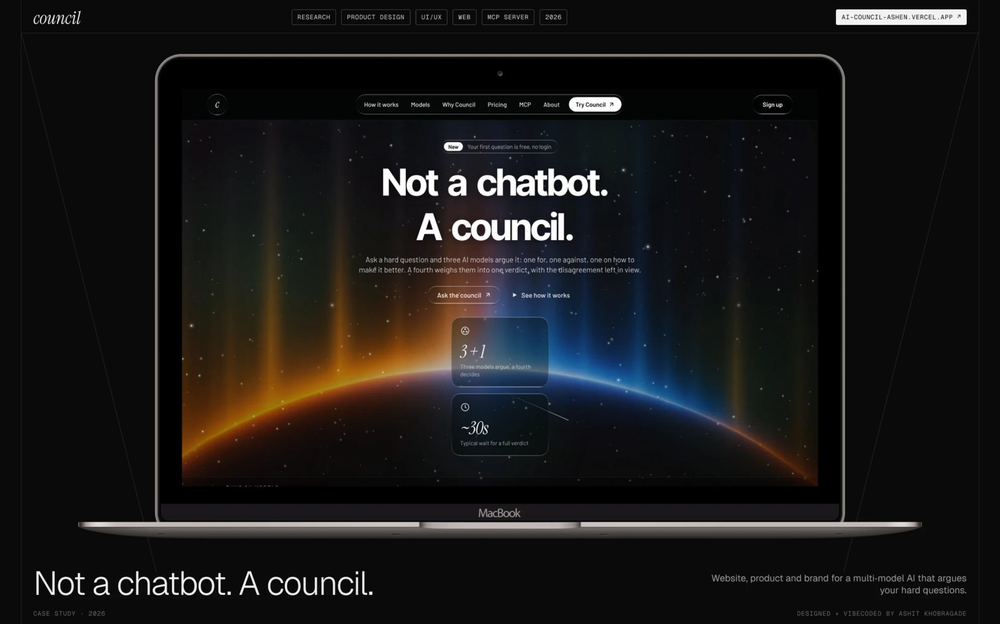
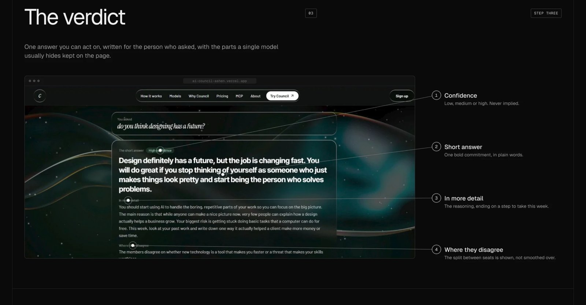
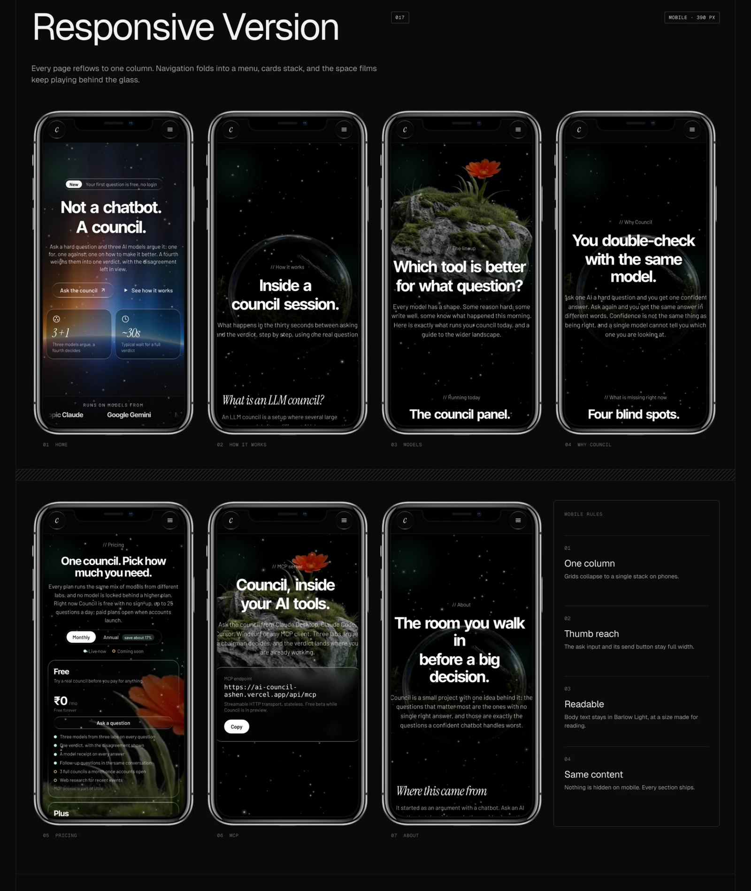
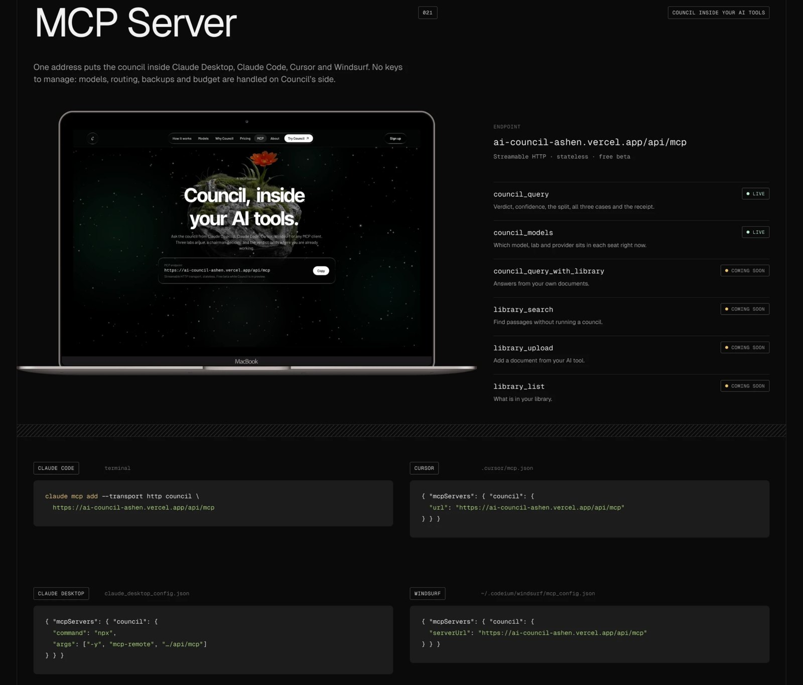

<div align="center">

# Council

**Not a chatbot. A council.**

A second opinion for decisions with no single right answer. Three AI models from different labs argue your question from fixed seats, and a chairman from a fourth lab weighs them into one verdict.

[**Try it live →**](https://ai-council-ashen.vercel.app) &nbsp;·&nbsp; [How it works](https://ai-council-ashen.vercel.app/how-it-works.html) &nbsp;·&nbsp; [MCP server](https://ai-council-ashen.vercel.app/mcp.html) &nbsp;·&nbsp; [Case study](https://ashitdesign.framer.website/work/projects/council-ai)




</div>

---

## Why Council

Ask one model a hard question and you get one confident voice, even when the honest answer is "it depends". It tends to agree with itself, its confidence is flat, and it gives everyone the same treatment.

Council splits the question across models that were trained by different companies and gives each one a job:

| Seat | Job | Model (default) |
| --- | --- | --- |
| **The case for** | Argues for the strongest version of the idea | GPT · OpenAI |
| **The case against** | Finds the reasons it could fail | Claude · Anthropic |
| **How to improve it** | Suggests what would make it work | Gemini · Google |
| **Chairman** | Weighs all three into one verdict | Qwen · Alibaba |

The chairman always runs on a different model from the three it judges. Questions with one correct answer ("capital of Peru") skip the debate and get a single line.



## What a verdict contains

- **A short answer** you can act on, then the longer reasoning.
- **A confidence level**, so a close call looks like a close call.
- **The disagreement left in view**: where the seats split and why.
- **A model receipt**: the exact model ID each provider reported, so the claims on the site can be checked.

## Features

- **Fact gate** — plain lookups are answered directly instead of being debated.
- **Debate or quick take** — full council in about 30 seconds, or one model in about 10.
- **Automatic fallbacks** — if a provider is slow, down or out of quota, the seat moves to the next model (gpt-oss, Llama, Mistral and others) without failing the answer.
- **Honest failures** — a seat that errors is marked `ok: false` and left out of the chairman's prompt; the final answer is never an error message dressed up as an answer.
- **MCP server** — ask the council from inside Claude, Cursor or Windsurf.
- **Rate limits and a daily budget** per visitor and for the whole site, so nobody can burn the quota.
- **Responsive** — ten pages, each reflowing to one column on phones.



## Use it from your AI tools (MCP)

Council runs as a stateless [Model Context Protocol](https://modelcontextprotocol.io) server at `/api/mcp`, with two tools: `council_query` (debate or quick take) and `council_models` (who sits in each seat right now).

```bash
# Claude Code
claude mcp add --transport http council https://ai-council-ashen.vercel.app/api/mcp
```

```json
// Cursor: ~/.cursor/mcp.json
{ "mcpServers": { "council": { "url": "https://ai-council-ashen.vercel.app/api/mcp" } } }
```



## How it's built

```
Browser ──POST /api/council──▶ Vercel serverless function
                                 ├─ fact gate ─▶ one-line answer
                                 └─ debate
                                     ├─ case for      (GPT)      ┐
                                     ├─ case against  (Claude)   ├─ in parallel, with backups
                                     ├─ improve it    (Gemini)   ┘
                                     └─ chairman      (Qwen) ─▶ verdict + receipt
```

- **Frontend:** hand-written HTML, CSS and JavaScript, no framework and no build step.
- **Backend:** `api/council.js` and `api/mcp.js`, Node.js serverless functions on Vercel. API keys live only on the server and never reach the browser.
- **Providers:** OpenAI, Anthropic, Google AI Studio, Groq, Cerebras, plus optional Mistral and OpenRouter. Model IDs are read live from each provider, so a retired model never breaks a seat.
- **Time budget:** seats must finish by 38 s and everything by 55 s, inside Vercel's 60 s limit.
- **Optional:** Upstash Redis for rate limits shared across function instances.

## Run your own

1. **Fork and import** this repo into [Vercel](https://vercel.com/new). Framework preset: *Other*. No build step.
2. **Add API keys** under *Settings → Environment Variables*. Any subset works; the more you add, the more reliable the council:

   | Variable | Where to get it | Notes |
   | --- | --- | --- |
   | `GROQ_API_KEY` | console.groq.com | free, no card |
   | `CEREBRAS_API_KEY` | cloud.cerebras.ai | free, no card |
   | `GEMINI_API_KEY` | aistudio.google.com | free tier |
   | `OPENAI_API_KEY` | platform.openai.com | prepaid, used up to `PAID_PER_DAY` |
   | `ANTHROPIC_API_KEY` | console.anthropic.com | prepaid, used up to `PAID_PER_DAY` |
   | `OPENROUTER_API_KEY`, `MISTRAL_API_KEY` | optional | extra fallbacks |
   | `UPSTASH_REDIS_REST_URL`, `UPSTASH_REDIS_REST_TOKEN` | upstash.com | optional shared rate limits |

   Tuning: `RATE_PER_HOUR` (8), `RATE_PER_DAY` (25), `GLOBAL_PER_DAY` (600), `PAID_PER_DAY` (150), `MCP_TOKENS` to require a bearer token on the MCP server.
3. **Deploy.** Every push to `main` redeploys automatically.

### API

`POST /api/council` with `{ "question": "...", "mode": "debate" | "quick" }`. The response is one of:

```js
{ kind: "fact", factAnswer, receipt }
{ kind: "quick", answer, model, receipt }
{ kind: "judgment", members: [...], chairman: { finalAnswer, confidence, split, ... }, receipt }
```

Errors come back as real HTTP status codes (`400`, `429`, `502`, `504`) with a plain-English `error`.

### Tests

```bash
npm test
```

The suite in `test/` runs the real handler against a mocked provider, so it needs no keys and no network.

## Project structure

```
api/council.js      the council: fact gate, seats, fallbacks, chairman, rate limits
api/mcp.js          MCP server (Streamable HTTP, stateless)
index.html          home + the ask box
how-it-works.html   one question followed through every step
models.html         who sits in each seat
mcp.html            connecting Council to Claude, Cursor and Windsurf
pricing.html        plans
test/               handler tests with a mocked provider
llms.txt            a plain-text summary for AI crawlers
```

## About

Researched, designed and vibecoded solo by **Ashit Khobragade**, a design student at IIT Delhi.

[Portfolio](https://ashitdesign.framer.website) · [Case study](https://ashitdesign.framer.website/work/projects/council-ai) · [LinkedIn](https://www.linkedin.com/in/ashit-k-4b14412b8) · [Behance](https://www.behance.net/ashitkhobragade1) · [Instagram](https://www.instagram.com/assshitt_/)
